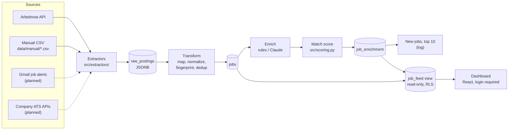

# job-market-etl

A personal **job-posting monitor**: an ETL pipeline that collects IT job postings from
several legal sources, unifies them, removes duplicates across sources, scores each job
against my profile, and shows what is new in a private dashboard. It runs every morning
on GitHub Actions against a Supabase Postgres database, and the same Docker image runs
locally.

Built with Python 3.14, PostgreSQL 17, Docker Compose, psycopg 3, pytest, GitHub Actions,
Supabase, React (Vite) and (optionally) the Claude API.

> **Version 2, in progress.** v1 (one source -> pandas -> Postgres, a learning project)
> is preserved as the git tag [`v1.0`](../../tree/v1.0). This README describes v2:
> see [Status](#status) for what works today and what is still being built.

**Hard rule: no web scraping.** Postings come only from legal sources: public APIs
(Arbeitnow), my own manual CSV notes, and (planned) my own email job alerts and public
company ATS APIs.

## Architecture



| Step | What it does | Code |
|------|--------------|------|
| **Extract** | Each enabled source (`SOURCES=arbeitnow,csv`) fetches its postings and stores them **unchanged** in `raw_postings` (JSONB). Re-seen postings only update `last_seen_at`. One failing source never stops the others. | `src/extractors/`, `src/raw_postings.py` |
| **Transform** | Maps each source's payload to one shape, cleans it, and computes a **fingerprint** (normalized company + title + city) to merge the same job from different sources into one row in `jobs`. Bad postings get a `transform_error` and are retried next run. | `src/mappers/`, `src/normalize.py`, `src/transform.py` |
| **Enrich** | Extracts seniority, category, skills, required years and required languages: free keyword **rules** for every job (Hungarian and Serbian too, Latin and Cyrillic), optionally upgraded by **Claude** for the most promising jobs. | `src/rules.py`, `src/enrich.py` |
| **Score** | A deterministic 0-100 **match score** against `config/profile.yaml`, with the reasons (`"+ PHP (3)"`, `"- requires 3+ years: score 0"`). Recomputed for every job on every run. | `src/scoring.py` |
| **Report** | At the end of each run: how many jobs are new, and the top 10 new ones with their reasons, in the log. | `src/main.py` |
| **Dashboard** | A private React page (magic-link login, only my account) listing `job_feed` by score, with filters. Read-only. | `dashboard/`, `migrations/005_*.sql` |
| **Tracker** | My applications and what happened to them; a trigger turns each event into the next follow-up date (phase 9, database part done). | `migrations/006_*.sql` |

Every step writes a row to `etl_runs` (status, row counts, error message).

## Status

| Works now | In progress / planned |
|-----------|-----------------------|
| Arbeitnow API and manual CSV sources | Gmail IMAP job-alert extractor (phase 4) |
| Raw data in Postgres, plain-SQL migrations | Company ATS extractors, `companies.yaml` (phase 5) |
| Cross-source deduplication (fingerprint) | A proper "new postings" report (phase 6) |
| Rule-based enrichment (EN/DE/HU/SR), optional Claude | Dashboard deployed on Vercel (works locally today) |
| Application tracker tables + follow-up trigger (9.1) | Job search assistant on the dashboard: AI search, tracker tab, letter drafts (phase 9.2-9.5) |
| Match score with reasons, profile in YAML | |
| Daily GitHub Actions run against Supabase | |
| Private read-only dashboard (React, magic-link login) | |
| ~370 tests (unit + local-database tests) | |

## Quick start (local, Docker only)

Requirements: Docker Desktop and git. Python is not needed on your machine.

```bash
git clone https://github.com/NagyDominik1/job-market-etl.git
cd job-market-etl
cp .env.example .env                                    # PowerShell: Copy-Item .env.example .env
cp config/profile.example.yaml config/profile.yaml      # then edit it (gitignored)
docker compose up --build
```

This starts Postgres, waits for its healthcheck, applies the migrations, and runs the
pipeline once. The log ends with the number of new jobs and the top 10 by score.
Run it again any time (nothing is duplicated):

```bash
docker compose run --rm pipeline
```

Manual postings: put CSV files into `data/manual/` (format in
[`data/manual/README.md`](data/manual/README.md), example in
[`data/examples/example.csv`](data/examples/example.csv)). They are gitignored.

### Look at the data

```bash
docker compose exec postgres psql -U <POSTGRES_USER from .env> -d job_market
```

```sql
-- Top 20 jobs by match score, with the reasons
SELECT e.match_score, j.title, j.company_name, j.location,
       array_to_string(e.match_reasons, ', ') AS reasons
FROM jobs j JOIN job_enrichment e ON e.job_id = j.id
ORDER BY e.match_score DESC, j.first_seen_at DESC LIMIT 20;

-- Jobs found in more than one source
SELECT j.title, j.company_name, string_agg(DISTINCT s.name, ', ') AS sources
FROM jobs j JOIN raw_postings r ON r.job_id = j.id JOIN sources s ON s.id = r.source_id
GROUP BY j.id HAVING count(DISTINCT r.source_id) > 1;

-- The run log
SELECT id, step, source_id, status, rows_extracted, rows_loaded, rows_enriched, error_message
FROM etl_runs ORDER BY id DESC LIMIT 20;
```

More example queries (top skills, seniority distribution) are in
[`sql/analysis.sql`](sql/analysis.sql).

## Configuration

Environment variables, from `.env` locally (variables already set in the shell win):

| Variable | Default | Meaning |
|----------|---------|---------|
| `DATABASE_URL` | – | A managed database (Supabase). Takes precedence over `POSTGRES_*`; uses `sslmode=require`. |
| `POSTGRES_HOST`, `POSTGRES_PORT`, `POSTGRES_DB`, `POSTGRES_USER`, `POSTGRES_PASSWORD` | – | The local Docker database. Use `127.0.0.1`, not `localhost` (Windows tries IPv6 first). |
| `SOURCES` | `arbeitnow,csv` | Enabled sources, in order |
| `ARBEITNOW_MAX_PAGES` | `3` | Pages per run from the Arbeitnow API |
| `CSV_DIR` | `data/manual` | Folder with the manual CSV files |
| `PROFILE_PATH` | `config/profile.yaml` | Profile for the match score; falls back to `config/profile.example.yaml` with a warning |
| `ANTHROPIC_API_KEY` | empty | Optional. Empty = rules only |
| `ANTHROPIC_MODEL` | `claude-haiku-4-5-20251001` | Model for the optional Claude extraction |
| `ENRICH_LIMIT` | `20` | Max jobs sent to Claude per run; `0` = no Claude calls |

## Running against Supabase

The same image can run against a managed Postgres database (Supabase) instead of the
local one. The local setup is unchanged; this is a separate, opt-in Compose service
(`pipeline-supabase`, profile `supabase`).

1. Create `.env.supabase` in the project root (gitignored, never commit it):

   ```
   DATABASE_URL=postgresql://postgres.<project-ref>:<password>@aws-1-<region>.pooler.supabase.com:5432/postgres
   SOURCES=arbeitnow
   ```

   Use the **Session pooler** connection string (Supabase *Connect* button, port 5432):
   the direct connection (`db.<project-ref>.supabase.co`) is IPv6-only, which Docker
   Desktop and GitHub Actions runners can't reach, and the transaction pooler (port 6543)
   doesn't support the prepared statements psycopg uses. Special characters in the
   password must be URL-encoded (`/` -> `%2F`, `@` -> `%40`, `#` -> `%23`, `%` -> `%25`);
   a generated letters-and-digits password avoids that.

2. Run migrations + pipeline once:

   ```bash
   docker compose --profile supabase run --rm --build pipeline-supabase
   ```

All tables have Row Level Security enabled with no policies (migration 004), so
Supabase's public REST API can't read or write them; the pipeline connects as the table
owner and is not affected. The tests never run against `DATABASE_URL`.

## Daily run on GitHub Actions

[`.github/workflows/pipeline.yml`](.github/workflows/pipeline.yml) runs every day at
05:00 UTC and on demand (**Actions -> Daily pipeline -> Run workflow**). It builds the
image from the same `Dockerfile` and runs it against Supabase with `SOURCES=arbeitnow`
(manual CSVs stay local). Repository secrets:

| Secret | Content |
|--------|---------|
| `DATABASE_URL` | the Supabase session-pooler URL |
| `PROFILE_YAML` | the contents of `config/profile.yaml`, written to the runner at run time |
| `ANTHROPIC_API_KEY` | optional |

A failing source exits with code 1, so the run turns red and GitHub sends an email.
Runs never overlap (concurrency group) and time out after 15 minutes. Scheduled
workflows only run on the default branch.

## Dashboard

A small Vite + React app in [`dashboard/`](dashboard/) (plain CSS, no UI framework). It
reads the `job_feed` view through Supabase's REST API with
[supabase-js](https://supabase.com/docs/reference/javascript): jobs sorted by match score,
filters for minimum score, city, "new in the last 24 hours / 7 days" and a text search
on title and company. Every filter runs in the database.

**Who can see what** (migration 005, tested in `tests/test_dashboard_access.py`):

| Caller | Database role | Access |
|--------|---------------|--------|
| Not logged in | `anon` | nothing: no privileges, no policies |
| Logged in (only my account; sign-ups are disabled) | `authenticated` | `SELECT` on `job_feed` only (and what the view needs); no writes, no raw payloads, no run log |
| The pipeline | table owner | everything (RLS doesn't apply to the owner) |

`job_feed` is created `WITH (security_invoker = true)`: the view checks the RLS policies
as the *caller*. A normal view runs as its owner and would bypass RLS for everyone
allowed to read it.

Run it locally (Node.js 22.12+):

```bash
cd dashboard
cp .env.example .env.local      # VITE_SUPABASE_URL, VITE_SUPABASE_ANON_KEY
npm install
npm run dev                     # http://localhost:5173
```

The anon (publishable) key is public by design: it is shipped to every browser. The data
is protected by the database (RLS and privileges), not by hiding the key. The
`service_role` key is never used by the dashboard.

Supabase settings: my user created by hand, **sign-ups disabled**, and the dashboard's
URLs (`http://localhost:5173/**`, the Vercel URL) in *Authentication -> URL
Configuration*. Deployment: Vercel project with **Root Directory = `dashboard`** and the
two `VITE_` environment variables.

## Application tracker (phase 9.1)

Migration [`006_application_tracker.sql`](migrations/006_application_tracker.sql), tested
in `tests/test_tracker.py`. Database only for now; the dashboard tab comes in 9.4.

- `applications`: company, position (empty = open application), letter language
  (`hu`/`sr`/`en`), CV variant, optional link to a pipeline job, deadline, status and the
  **next action** (date + a Hungarian reason, e.g. "3 hete elküldve, írj emlékeztetőt").
- `application_events`: what happened. Inserting an event fires a trigger that updates the
  application, so the follow-up rules live in one place:

| Event | Status | Next action |
|-------|--------|-------------|
| `saved` | saved | deadline - 2 days (none without a deadline) |
| `sent` | sent (`applied_at` = event date) | + 21 days |
| `forwarded` | in_progress | + 14 days |
| `stated_date` | in_progress | the date they gave |
| `reply`, `interview` | in_progress | the given date, else + 14 days |
| `follow_up_sent` | unchanged | + 14 days; the 2nd one since their last sign of life -> `no_response`, none |
| `rejection` / `offer` | rejected / offer | none |
| `note` | unchanged | unchanged |

- `company_key` is a **generated column**: `normalize_company_key()` is the SQL twin of
  `normalize_company()` in Python (a test checks they agree), so `ErdSoft d.o.o.` and
  `ERDSOFT Kft.` give `erdsoft` whoever inserts the row (dashboard, Edge Function). The AI
  search (9.3) uses it to skip companies I already applied to.
- Views `todays_actions` ("Ma teendő": active, next action due) and `expiring` (saved,
  deadline passed or within 3 days), both `security_invoker`. "Today" is Budapest time
  (`local_today()`), not the server's UTC date.
- Access: RLS on, `SELECT` for `authenticated` only, `anon` nothing; write policies come
  with the dashboard tab (9.4).

## Design decisions

- **Raw data in the database.** Every posting is stored unchanged (JSONB) before any
  cleaning, so a mapping bug can be fixed and re-processed without downloading again. A
  GitHub Actions runner has no persistent disk, so files would be lost.
- **Plain SQL migrations.** Numbered `.sql` files in `migrations/`, applied by
  [`src/migrate.py`](src/migrate.py) on startup, each in its own transaction (Postgres can
  roll back DDL). Applied files are never edited: a checksum check enforces it.
- **Idempotent everywhere.** `UNIQUE(source_id, external_id)` + `ON CONFLICT` for raw
  data, `UNIQUE(fingerprint)` for jobs, `IS DISTINCT FROM` so reruns rewrite nothing.
  New vs. already seen is counted per row with `RETURNING (xmax = 0)`.
- **Cross-source dedup by fingerprint.** `sha256(company|title|city)` after
  normalization: lowercase, Serbian Cyrillic -> Latin, no accents, legal forms removed
  (`d.o.o.` = `Kft.` = `GmbH`), gender markers removed, city aliases (Szabadka =
  Subotica). One raw posting belongs to exactly one job: a 1:n foreign key, no link table.
- **Isolation of failures.** One transaction per source and per raw posting; failures are
  recorded (`etl_runs`, `transform_error`) and the rest continues.
- **AI for extraction, code for decisions.** Claude (optional) only extracts facts a
  posting states, via structured outputs, validated again in Python and by `CHECK`
  constraints. The match score is plain, deterministic, unit-tested Python with a reason
  for every point. Without an API key, or if a call fails, the rule-based result stays.
- **Same image locally and in CI; config by environment.** Only `DATABASE_URL` and the
  secrets differ. The personal profile is gitignored and comes from a secret in CI.
- **Secure defaults.** Postgres bound to `127.0.0.1` locally, TLS to Supabase, Row Level
  Security on every table, a non-root container user, secrets never logged.
- **Least privilege for the dashboard.** Two independent locks: table privileges
  (`REVOKE ALL`, then `GRANT SELECT` only on what the view needs, not the raw payload) and
  RLS policies (`SELECT` for `authenticated` only). The view uses `security_invoker`, so
  it can't bypass them. Login is a magic link to the only existing account.

## Known limitations

- The same job with a Hungarian and a Serbian (or English) title is not matched: the
  fingerprint compares normalized text, it doesn't translate.
- Role keywords in the profile are matched literally ("php developer" does not match
  "PHP fejlesztő"); locations like "UK - Remote" don't count as remote.
- Rule-based extraction is keyword-based and can misread a sentence; Claude is more
  accurate but optional and limited per run.
- The first transform against a remote database is slow (one round trip per posting);
  later runs only process new postings.

## Project structure

```
├── .github/workflows/pipeline.yml   # daily run on GitHub Actions
├── docker-compose.yml               # postgres + pipeline (+ pipeline-supabase, opt-in)
├── Dockerfile                       # the pipeline image (python:3.14.8-slim, non-root)
├── config/profile.example.yaml      # profile structure (my real profile.yaml is gitignored)
├── migrations/                      # 001-006 plain SQL migrations
├── dashboard/                       # Vite + React dashboard (deployed separately)
├── data/manual/README.md            # CSV format (the CSV files themselves are gitignored)
├── sql/analysis.sql                 # example analysis queries
├── src/
│   ├── main.py                      # runner: migrate -> extract -> transform -> enrich -> report
│   ├── extractors/                  # Extractor interface, Arbeitnow, CSV
│   ├── mappers/                     # source payload -> NormalizedJob
│   ├── normalize.py                 # folding, normalization, fingerprint
│   ├── transform.py                 # raw_postings -> jobs (dedup, merge)
│   ├── rules.py / enrich.py         # rule-based and Claude extraction
│   ├── scoring.py                   # match score with reasons
│   ├── migrate.py / db.py / runs.py # migrations, connection, run log
│   └── ...
└── tests/                           # pytest; DB tests use a temporary schema
```

## Local development

```bash
docker compose up -d postgres                     # only the database
python -m venv .venv
.venv\Scripts\python -m pip install -r requirements.txt
.venv\Scripts\python -m src.main                  # the whole pipeline
.venv\Scripts\python -m pytest                    # all tests
```

Single steps: `python -m src.migrate`, `python -m src.transform`, `python -m src.enrich`.
The database tests run in a temporary schema of the local database and are skipped
when it isn't running or when `DATABASE_URL` is set. Tests in the container:
`docker compose run --rm pipeline python -m pytest`.
